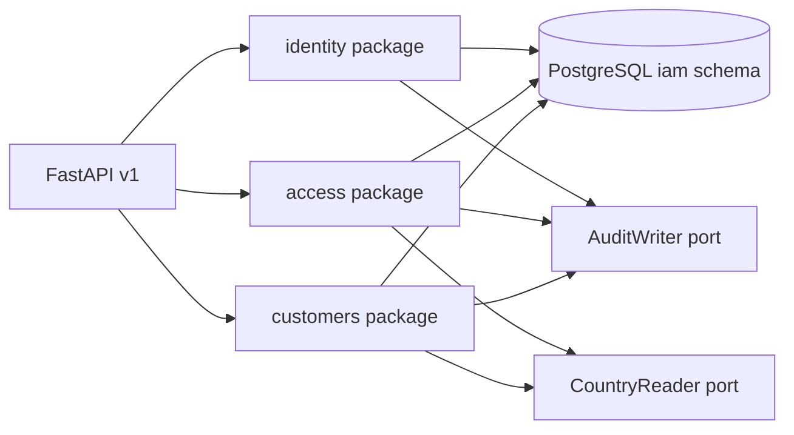
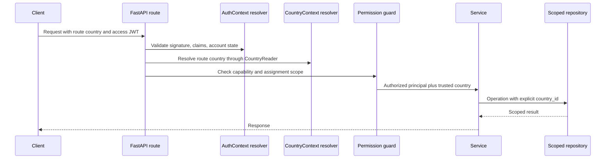

# Identity, Access, and Customer Backend Architecture

## 1. Purpose

Define the backend architecture for identity, authentication, authorization, and
individual customer data in the Sukilo multi-country marketplace.

This design follows:

- `Multi_Country_Marketplace_Database_Architecture_and_Schema_Design_v1.0.pdf`
- `Multi_Country_Multi_Vendor_Marketplace_Product_Technical_Specification.pdf`
- `AGENTS.md`

The design is implementation-ready but does not implement application code.

## 2. Scope

Included:

- First-party email identity with password authentication and email OTP.
- Optional linked phone identity.
- Optional SMS OTP through an adapter.
- Short-lived JWT access tokens.
- Opaque, rotating refresh tokens backed by hashed server-side sessions.
- Device/session listing, revocation, and sign-out-all.
- Global RBAC definitions with country, vendor, and store ABAC scopes.
- Individual customer profile projection, preferences, consent, and addresses.
- Country isolation contracts, privileged-action audit contracts, and selective
  PostgreSQL Row Level Security (RLS).
- Account closure and eligible PII pseudonymization.

Excluded:

- Frontend implementation.
- Vendor, store, catalog, product, order, payment, and logistics models.
- Business buyer organizations and private B2B pricing.
- Social login in the initial implementation.
- Full market and platform schemas.
- The current temporary product implementation.

## 3. Architecture decisions

1. Use one PostgreSQL database per environment.
2. Store all entities in this design in the `iam` PostgreSQL schema.
3. Split Python ownership into `identity`, `access`, and `customers` packages.
4. Keep `iam.user_account` as the canonical human account. Do not create a
   duplicate customer master.
5. Treat “customer” as a user acting on their own account. Future vendor staff,
   administrators, and business buyers reuse the same account identity.
6. Treat FastAPI authorization as the primary control. Add selective RLS only as
   defense in depth.
7. Resolve country context on the server. Never authorize from an unverified
   request body or token claim alone.
8. Use RBAC for capabilities and ABAC for resource and tenant scope.
9. Keep access tokens short-lived and stateless; keep refresh-session state and
   revocation server-side.
10. Store no raw password, OTP, refresh token, or infrastructure secret.
11. Keep B2B organizations outside `iam`; add them later in the pricing/customer
    organization domain without changing account IDs.

### 3.1 Global account and country mobility

`iam.user_account` is global and has no owning `country_id`. The country used
during registration is the initial market context, not the permanent home of
the account.

A customer who registers in Nepal can later authenticate with the same account
in UAE, Vietnam, or Cambodia. On entering another market, the backend:

1. Authenticates the same global `user_id`.
2. Resolves the requested country independently from the access token.
3. Requires that country's current terms/privacy consent when applicable.
4. Validates a country-compatible locale, currency, address, and optional local
   phone requirement.
5. Creates country-scoped carts, orders, and other future commercial records.

Changing preferred country never creates another account, changes `user_id`, or
transfers country-scoped privileges. `COUNTRY_ADMIN`, vendor, store, and future
business-buyer access requires a separate assignment or approval in the target
country. Carts and transactions never move silently between countries.

### 3.2 Enum and lookup policy

Use Python string enums for small, stable technical state sets such as account
status, scope type, OTP purpose, grant purpose, and address type. Persist them
as constrained `VARCHAR` values, not native PostgreSQL enum types, so lifecycle
changes remain reversible through normal migrations.

Roles, permissions, countries, vendor staff roles, and configurable business
workflows are database records, never source-code enums. This permits scoped
assignments, retirement, auditing, and future custom vendor roles without an
application deployment for every definition change.

## 4. Bounded contexts and dependencies



### 4.1 `identity`

Owns:

- `iam.user_account`
- `iam.auth_identity`
- `iam.otp_challenge`
- `iam.auth_grant`
- `iam.user_session`
- Registration, verification, password login/reset, token refresh, and session
  revocation.
- Password hashing, OTP generation/verification, JWT signing/validation, and
  refresh-token rotation.

May call:

- `AuditWriter` for security-relevant lifecycle events.
- Notification adapters for OTP delivery.
- Rate-limit and risk-signal ports.

Must not:

- Decide tenant permissions.
- Update customer preferences or addresses.
- Query vendor, order, or product tables.

### 4.2 `access`

Owns:

- `iam.role`
- `iam.permission`
- `iam.role_permission`
- `iam.user_role_assignment`
- Permission resolution, scope validation, authorization guards, and assignment
  administration.

May call:

- `CountryReader` to validate active country scopes.
- Future vendor/store scope readers through narrow ports.
- `AuditWriter` for every privileged assignment change.

Must not:

- Validate passwords or issue tokens.
- Read business resources directly to infer ownership.

### 4.3 `customers`

Owns:

- `iam.user_preference`
- `iam.consent_record`
- `iam.address` for customer-owned addresses.
- The `/me` projection and self-service profile operations.

May call:

- `CountryReader` to validate countries, locales, currencies, and geography.
- `AuditWriter` for consent, sensitive profile, and address security events.

Must not:

- Store credentials.
- Create separate account IDs.
- Implement vendor-owned addresses in these phases.

### 4.4 Dependency direction

Routes depend on services, services depend on repositories and ports, and
repositories depend on SQLAlchemy models. Domain packages do not import route
modules. Cross-domain access uses typed ports rather than another package's
repository.

## 5. Proposed backend layout

```text
app/
  api/v1/
    endpoints/
      auth.py
      access.py
      customers.py
  core/
    auth_context.py
    country_context.py
    security.py
    transactions.py
  ports/
    country.py
    audit.py
  modules/
    identity/
      models/
        __init__.py
        user_account.py
        auth_identity.py
      schemas.py
      repository.py
      service.py
      tokens.py
      passwords.py
      otp.py
      grants.py
      ports.py
    access/
      models.py
      schemas.py
      repository.py
      service.py
      policies.py
      dependencies.py
      ports.py
    customers/
      models.py
      schemas.py
      repository.py
      service.py
      ports.py
tests/
  unit/
    identity/
    access/
    customers/
  integration/
    identity/
    access/
    customers/
  security/
```

Public functions and classes follow the docstring and typing requirements in
`AGENTS.md`. Route handlers remain thin; services own business rules and
repositories own persistence. Each SQLAlchemy table is defined in its own model
file, and each table is introduced by its own Alembic revision after any shared
schema/extension prerequisite revision.

## 6. Schema ownership

All physical table names are singular and schema-qualified.

### 6.1 `iam.user_account`

Canonical human account.

Required columns:

- `user_id UUID PRIMARY KEY`
- `email CITEXT NULL`
- `phone_e164 VARCHAR(24) NULL`
- `password_hash TEXT NULL`
- `email_verified_at TIMESTAMPTZ NULL`
- `phone_verified_at TIMESTAMPTZ NULL`
- `status VARCHAR(24) NOT NULL`
- `auth_version INTEGER NOT NULL DEFAULT 1`
- `last_login_at TIMESTAMPTZ NULL`
- `closed_at TIMESTAMPTZ NULL`
- `created_at TIMESTAMPTZ NOT NULL`
- `updated_at TIMESTAMPTZ NOT NULL`
- `version INTEGER NOT NULL DEFAULT 1`

Constraints and indexes:

- Status is one of `PENDING`, `ACTIVE`, `SUSPENDED`, or `CLOSED`.
- Partial unique indexes enforce uniqueness for non-null email and phone.
- Email and phone are normalized before persistence.
- Initial self-registration requires a normalized email and password. The
  schema permits future phone-first, passwordless, or external identities, but
  those account forms are not enabled until they have complete verification and
  recent-authentication policies.
- A usable account has at least one verified login identity or linked
  `auth_identity`. This cross-table invariant is enforced by the identity
  service in the account-creation transaction.
- Closing an account never deletes referenced transaction history.
- Incrementing `auth_version` invalidates access tokens and authorization cache
  entries after a security-sensitive change.

### 6.2 `iam.auth_identity`

Links an account to a local or future external identity.

Required columns:

- `auth_identity_id UUID PRIMARY KEY`
- `user_id UUID NOT NULL REFERENCES iam.user_account`
- `provider VARCHAR(32) NOT NULL`
- `provider_subject VARCHAR(255) NOT NULL`
- `created_at TIMESTAMPTZ NOT NULL`

Constraints:

- Unique `(provider, provider_subject)`.
- Phase 1 seeds `LOCAL`; future providers do not change `user_account`.

### 6.3 `iam.otp_challenge`

Represents one short-lived verification or recovery challenge.

Required columns:

- `otp_id UUID PRIMARY KEY`
- `user_id UUID NULL REFERENCES iam.user_account`
- `destination_hash TEXT NOT NULL`
- `otp_nonce TEXT NOT NULL`
- `channel VARCHAR(16) NOT NULL`
- `purpose VARCHAR(32) NOT NULL`
- `otp_hash TEXT NOT NULL`
- `attempt_count SMALLINT NOT NULL DEFAULT 0`
- `max_attempts SMALLINT NOT NULL`
- `expires_at TIMESTAMPTZ NOT NULL`
- `verified_at TIMESTAMPTZ NULL`
- `invalidated_at TIMESTAMPTZ NULL`
- `created_at TIMESTAMPTZ NOT NULL`

Rules:

- Channel is `EMAIL` or `SMS`.
- Initial purposes are `REGISTER`, `LOGIN`, `RESET`, `VERIFY_EMAIL`,
  `VERIFY_PHONE`, and `STEP_UP`.
- The normalized destination is represented by a keyed HMAC so it can be
  matched without storing the destination in this table.
- The low-entropy OTP is protected with a keyed digest and per-challenge nonce;
  a plain unsalted digest is forbidden.
- Key IDs and digest algorithms are encoded into self-describing digest strings
  for `destination_hash` and `otp_hash`, for example
  `<key_id>$<algorithm>$<digest>`. The nonce remains a separate random column.
- A challenge is single-use and cannot be verified after expiry, invalidation,
  success, or maximum attempts.

### 6.4 `iam.auth_grant`

Represents a short-lived, opaque, single-use authorization created after a
successful OTP or recent-authentication ceremony.

Required columns:

- `grant_id UUID PRIMARY KEY`
- `user_id UUID NOT NULL REFERENCES iam.user_account`
- `session_id UUID NULL REFERENCES iam.user_session`
- `purpose VARCHAR(32) NOT NULL`
- `action_class VARCHAR(64) NULL`
- `subject_hash TEXT NULL`
- `token_hash TEXT NOT NULL UNIQUE`
- `authentication_methods JSONB NOT NULL`
- `issued_at TIMESTAMPTZ NOT NULL`
- `expires_at TIMESTAMPTZ NOT NULL`
- `consumed_at TIMESTAMPTZ NULL`
- `revoked_at TIMESTAMPTZ NULL`
- `correlation_id UUID NOT NULL`

Initial purposes are `RESET_PASSWORD`, `STEP_UP`, `CHANGE_EMAIL`,
`CHANGE_PHONE`, `CLOSE_ACCOUNT`, `DATA_EXPORT`, and `DOWNLOAD_EXPORT`.

The raw grant token has at least 256 bits of entropy and is returned once. Only
a self-describing keyed digest is stored. Consumption locks the row and writes
`consumed_at` in the same transaction as the protected state change. A grant is
bound to its user, optional session, purpose, action class, and optional
candidate/resource fingerprint; it cannot be replayed for another action or
subject.

### 6.5 `iam.user_session`

Represents a refresh-token session and token family.

Required columns:

- `session_id UUID PRIMARY KEY`
- `family_id UUID NOT NULL`
- `user_id UUID NOT NULL REFERENCES iam.user_account`
- `refresh_token_hash TEXT NOT NULL`
- `device_id VARCHAR(128) NULL`
- `device_name VARCHAR(160) NULL`
- `ip_hash TEXT NULL`
- `user_agent_hash TEXT NULL`
- `issued_at TIMESTAMPTZ NOT NULL`
- `last_used_at TIMESTAMPTZ NULL`
- `expires_at TIMESTAMPTZ NOT NULL`
- `rotated_at TIMESTAMPTZ NULL`
- `replaced_by_session_id UUID NULL REFERENCES iam.user_session`
- `revoked_at TIMESTAMPTZ NULL`
- `revoke_reason VARCHAR(64) NULL`
- `created_at TIMESTAMPTZ NOT NULL`

Rules:

- Only a hash of the opaque refresh token is stored.
- Refresh, IP, and user-agent digest strings encode their key ID and algorithm
  so pepper rotation does not require separate key-ID columns.
- A refresh operation atomically consumes the current row and creates its
  replacement in the same family.
- Reuse of a consumed token revokes every live session in that family.
- Sign-out-all revokes all live sessions and increments account `auth_version`.

### 6.6 Access-control tables

`iam.role` contains a unique stable code, display name, expected scope type, and
lifecycle status.

`iam.permission` contains a unique capability code and description.

`iam.role_permission` has composite primary key `(role_id, permission_id)`.

`iam.user_role_assignment` contains:

- `assignment_id UUID PRIMARY KEY`
- `user_id`, `role_id`, and `scope_type`
- Optional `scope_id`
- Denormalized optional `country_id` and `vendor_id` for efficient filtering
- `valid_from`, `valid_to`, `created_by`, `created_at`, and `revoked_at`

Scope checks:

- `GLOBAL`: `scope_id`, `country_id`, and `vendor_id` are null.
- `COUNTRY`: `scope_id = country_id`; `vendor_id` is null.
- `VENDOR`: `scope_id = vendor_id`; `country_id` is required.
- `STORE`: `scope_id` is the store ID; `country_id` and `vendor_id` are required.
- No overlapping active duplicate assignment for the same user, role, and
  scope. A PostgreSQL exclusion strategy or serialized service transaction
  enforces this for validity ranges.
- The grantor cannot grant capabilities they are not authorized to delegate.

### 6.7 Customer tables

`iam.user_preference` is one-to-one with `user_account` and stores optional
preferred country, locale, and display currency plus communication preferences.
Country, locale, and currency remain separate concepts.

`iam.consent_record` is append-only and stores user, country, consent type,
policy version, granted/withdrawn value, source, and recorded time. Current
consent is derived from the latest record for a type and country.

`iam.address` initially stores customer-owned addresses:

- `address_id UUID PRIMARY KEY`
- `user_id UUID NOT NULL REFERENCES iam.user_account`
- `country_id UUID NOT NULL`
- Optional normalized `geography_area_id`
- Recipient, delivery phone, address lines, landmark, fallback city, postal code,
  coordinates, address type, shipping/billing flags, and default flags
- `created_at`, `updated_at`, and optimistic `version`

A user can have at most one active default shipping address and one active
default billing address per country. Default changes lock affected rows in one
transaction. Orders later copy immutable snapshots; they never rely on a mutable
address row for historical fulfillment.

Vendor addresses are added by the future vendor domain. They do not make
customer `user_id` nullable in these phases.

## 7. Narrow external contracts

### 7.1 Country contract

`CountryReader` supplies only:

- Resolve a country code to its stable ID.
- Confirm country status permits the requested operation.
- Confirm a locale is enabled for a country.
- Confirm a display currency is enabled for a country.
- Confirm a geography area belongs to a country.
- Return validated country-specific address rules.
- Return the active policy version for a consent type.

The source may initially be a minimal `market.country` implementation or a test
adapter. Identity/access/customer code must not query broader market tables.

### 7.2 Audit contract

`AuditWriter.stage()` accepts an `AuditEventInput` and the active
`DatabaseTransaction`:

- Actor user ID and optional effective/assumed user ID.
- Country/vendor scope when present.
- Stable action code.
- Resource type and ID.
- Redacted before/after data.
- IP/user-agent hashes and correlation ID.

Privileged role changes and security lifecycle events are recorded atomically
with the state change through the platform audit implementation or a
transactional outbox. The implementation inserts through the same SQLAlchemy
session and never commits independently. Logging is not a substitute for this
audit record. Production endpoints remain disabled when only the development
no-op adapter is configured.

## 8. Trusted request context



`AuthContext` contains account ID, session ID, authentication time, assurance
level, and correlation ID. `CountryContext` contains trusted country ID and
country code. A route that is global does not manufacture a country context.

Country-scoped repositories require `country_id` as a non-optional parameter.
There is no unscoped list/get method for country-admin or vendor use cases.

## 9. Authentication lifecycle

### 9.1 Registration and verification

1. Normalize the required email and optional phone.
2. Return an enumeration-safe acceptance response.
3. Apply destination, account, IP, and device rate limits.
4. Create or reuse a safe pending account according to policy.
5. Invalidate older active challenges for the same destination and purpose.
6. Create an OTP challenge with a five-minute default expiry.
7. Send the raw OTP only through the notification adapter.
8. Verify atomically, incrementing attempts on failure.
9. Mark the identifier verified and activate the account when policy is met.
10. Write a security audit event without storing the raw destination or OTP.

For password reset, step-up, identifier change, closure, and export, successful
verification creates a purpose-bound `auth_grant` rather than performing an
unrelated action. The target service atomically consumes that grant while
performing the protected change.

### 9.2 Password login

1. Normalize the supplied identifier.
2. Perform a constant-behavior lookup and password verification.
3. Reject non-active accounts without revealing account existence.
4. Rehash on successful login when password parameters are outdated.
5. Create a refresh session and issue a short-lived access JWT.
6. Update `last_login_at` and emit a security event.

### 9.3 Access JWT

Required claims:

- `iss`, `aud`, `sub`, `iat`, `nbf`, `exp`, and `jti`
- `sid` for session ID
- `av` for account authorization version
- `amr` for authentication methods
- `auth_time` for step-up freshness

Default lifetime is ten minutes and remains configurable. Do not put full role
assignments or lists of country/vendor IDs in the token; resolve them through the
access service/cache using `sub` and `av`.

### 9.4 Refresh rotation

1. Hash and locate the presented opaque token.
2. Lock the session row.
3. Reject expired or revoked sessions.
4. If already rotated, revoke the token family and report suspected replay.
5. Create a replacement session row and mark the current row consumed.
6. Return a new refresh token and access JWT only after transaction commit.

## 10. Authorization model

Authorization answers both:

1. Does the principal have the required permission?
2. Does an active assignment cover the target resource scope?

Example:

```text
permission: customer.address.read
principal: authenticated account
resource owner: same account
result: allow only when principal.user_id == address.user_id
```

```text
permission: vendor.staff.manage
assignment: role VENDOR_OWNER in vendor V and country C
resource: staff member in vendor V and country C
result: allow only when vendor and country both match
```

The initial permission catalog includes:

- `customer.profile.read`
- `customer.profile.write`
- `customer.preference.write`
- `customer.consent.write`
- `customer.address.read`
- `customer.address.write`
- `iam.session.read`
- `iam.session.revoke`
- `iam.role.read`
- `iam.assignment.read`
- `iam.assignment.grant`
- `iam.assignment.revoke`

Customer self-service policies are ownership policies, not global role grants.
Administrative assignment APIs require explicit permissions and scope.

## 11. API conventions

Base path is `/api/v1`.

Identity routes:

- `POST /auth/register`
- `POST /auth/otp/request`
- `POST /auth/otp/verify`
- `POST /auth/login`
- `POST /auth/password/forgot`
- `POST /auth/password/reset`
- `POST /auth/step-up/request`
- `POST /auth/token/refresh`
- `POST /auth/logout`
- `GET /auth/sessions`
- `DELETE /auth/sessions/{session_id}`
- `POST /auth/sessions/revoke-all`

Access routes:

- `GET /access/roles`
- `GET /access/permissions`
- `GET /access/assignments`
- `POST /access/assignments`
- `DELETE /access/assignments/{assignment_id}`

Customer routes:

- `GET /me`
- `PATCH /me`
- `POST /me/identifier-change/confirm`
- `GET /me/preferences`
- `PUT /me/preferences`
- `GET /me/consents`
- `POST /me/consents`
- `GET /me/addresses`
- `POST /me/addresses`
- `GET /me/addresses/{address_id}`
- `PATCH /me/addresses/{address_id}`
- `DELETE /me/addresses/{address_id}`
- `POST /me/addresses/{address_id}/default`
- `POST /me/closure`
- `POST /me/closure/confirm`
- `POST /me/data-export/verification`
- `POST /me/data-export`
- `GET /me/data-exports/{export_request_id}`
- `POST /me/data-exports/{export_request_id}/download-grant`
- `POST /me/data-exports/{export_request_id}/download`

Mutating responses include a correlation ID. Error responses use:

```json
{
  "error": {
    "code": "AUTH_INVALID_CREDENTIALS",
    "message_key": "auth.invalid_credentials",
    "correlation_id": "uuid"
  }
}
```

Use `400` for malformed state transitions, `401` for absent/invalid
authentication, `403` for denied permission/scope, `404` when hiding resource
existence is safer, `409` for uniqueness/version conflicts, `422` for request
validation, and `429` for rate limits.

## 12. Security baseline

- Argon2id password hashing with parameters measured for the deployment tier.
- Asymmetric JWT signing with key IDs and rotation; keys come from a secret
  manager.
- Constant-time comparison for token and OTP digests.
- Strict CORS allow-list; never wildcard origins with credentials.
- Secure, HTTP-only, same-site refresh cookie when browser transport is used.
- CSRF protection for cookie-authenticated mutating requests.
- Rate limits in Redis or another shared store, never process memory in
  multi-instance production.
- Separate limits for OTP request, OTP verify, login, password reset, and token
  refresh.
- Mask email, phone, address, IP, and user-agent data in logs.
- No raw credentials, tokens, or OTPs in logs, traces, audit payloads, or error
  details.
- Step-up authentication is required for future finance/admin high-risk actions.
- Security notifications cover password reset, new session, refresh replay,
  sign-out-all, and sensitive identifier changes.

## 13. RLS strategy

Application authorization is completed before RLS is enabled.

Initial RLS candidates:

- `iam.user_role_assignment`
- `iam.consent_record`
- `iam.address`

Each transaction sets trusted values with transaction-local PostgreSQL settings,
for example account and country IDs. Pool-level or session-persistent settings
are forbidden. Policies deny access when context is absent. Migration and
maintenance roles bypass RLS through separate, controlled credentials.

RLS tests must prove:

- Context is cleared when a pooled connection is reused.
- A customer cannot read another customer's row.
- A country admin cannot read another country's scoped row.
- A super-admin destructive operation still requires an explicit country.

## 14. Transactions and concurrency

- Registration and identifier linking are atomic.
- OTP verification locks the challenge row.
- Auth-grant consumption locks the grant and performs the protected state
  change in the same transaction.
- Refresh rotation locks the session row and creates the replacement in one
  transaction.
- Role assignment and its audit/outbox event commit together.
- Default-address changes lock the user's active defaults for the country.
- Optimistic versions reject lost profile/address updates with `409`.
- External email/SMS calls occur after intent persistence and outside the
  database transaction.

## 15. Deferred extensions

### 15.1 Social login

Add provider-specific `auth_identity` rows after validating issuer, audience,
nonce, and provider subject. Account linking requires recent authentication and
must not merge accounts based only on an unverified email.

### 15.2 Vendor and store scopes

The vendor domain supplies resource-scope readers. Existing access assignments
already carry vendor/store scope shapes, but vendor/store foreign keys and role
seeds are introduced with that domain's migration.

### 15.3 Business buyers

Add country-scoped business organizations and memberships outside `iam`.
Membership links stable `user_id` values. Business verification and private
pricing eligibility remain separate from platform RBAC.

### 15.4 Immutable order addresses

The future commerce module snapshots selected address data into the order.
Changing or deleting a customer address never mutates historical orders.

## 16. Phase map and requirement traceability

- Phase 1: database/schema foundation, canonical accounts, local identities,
  package boundaries, country/audit ports.
- Phase 2: FR-ID-001 through FR-ID-003; registration, OTP, passwords, tokens,
  and sessions.
- Phase 3: FR-ID-004, FR-ADM-001, role/permission assignments, RBAC+ABAC, and
  privileged audit.
- Phase 4: FR-CUS-005; `/me`, preferences, consent, and addresses.
- Phase 5: AC-11 cross-country tampering, RLS defense, closure/privacy,
  observability, and adversarial acceptance tests.

## 17. Global completion conditions

This subsystem is ready for dependent marketplace modules when:

- All public IDs are UUIDs and all country-scoped calls use trusted context.
- Authentication supports secure registration, recovery, refresh rotation, and
  session revocation.
- Permissions and scopes are independently enforced on commands and queries.
- Customer profile, preference, consent, and address ownership tests pass.
- Cross-account and cross-country tampering tests fail closed.
- Sensitive values are absent from logs and persisted only in protected form.
- RLS connection-pool leakage tests pass for selected tables.
- Requirement-to-test evidence is recorded for every phase exit criterion.
