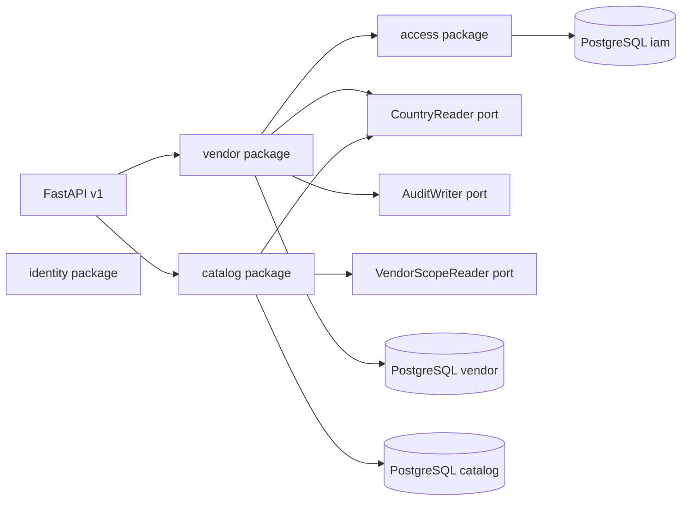

# Vendor, Store, and Catalog Backend Architecture

## 1. Purpose

Define the backend architecture for seller organizations, country approval,
stores, warehouses, shared catalog records, and seller offers in the Sukilo
multi-country marketplace.

This design follows:

- `docs/backend/identity-access-customer/architecture.md`
- `Multi_Country_Marketplace_Database_Architecture_and_Schema_Design_v1.0.pdf`
- `Multi_Country_Multi_Vendor_Marketplace_Product_Technical_Specification.pdf`
- `AGENTS.md`

The design is implementation-ready but does not implement application code.

## 2. Scope

Included:

- One seller organization per application, reused by every later country.
- One country application row per vendor and market.
- Document metadata, payout destination, membership, store, and warehouse.
- Country review that approves or rejects with a reason and an audit event.
- Owner and staff badges on the existing `iam.user_account`.
- Shared category, attribute, and brand records, with per-country availability.
- Shared product and SKU identity, media, one seller offer, and per-country
  offer publication.

Excluded:

- A second login, password, or customer master for sellers.
- Cart, checkout, marketplace orders, payments, refunds, and payout execution.
- Inventory ledger, reservation, and warehouse quantity.
- Ads, vouchers, chat, reviews, ranking, and the vector image stack.
- Public registration as super admin, country admin, vendor owner, or vendor staff.
- Replacement of the temporary `public.products` tables in the first vendor
  phases. Those tables stay until a later cutover.

## 3. Architecture decisions

1. Use the same PostgreSQL database. Add PostgreSQL schemas `vendor` and
   `catalog`. Do not put seller tables in `iam`.
2. Keep `iam.user_account` as the only human record. `created_by_user_id`,
   `vendor_member.user_id`, and role assignments all point at that `user_id`.
3. Treat Shop and Seller Center as two clients of the same authentication
   routes. This module does not add a seller login endpoint.
4. Separate the seller organization from country permission to sell.
   `vendor.vendor` can exist while `vendor.vendor_country` is still a draft.
5. Nepal approval never creates a UAE selling right. A second country requires
   its own `vendor_country` row, review, store, and warehouse.
6. Approval creates the country decision, the active owner membership, and the
   `VENDOR_OWNER` assignment in one transaction. The public assignment route
   remains unable to grant `SUPER_ADMIN`.
7. Staff access starts only when the invited account accepts. Sending an email
   is not acceptance.
8. Do not seed `VENDOR_OWNER`, `VENDOR_STAFF`, or `STORE_STAFF` until the
   migration that can point those assignments at a real vendor or store.
9. Keep product identity shared. Two sellers of one SKU create two
   `catalog.seller_offer` rows and do not clone `catalog.product`.
10. Resolve country on the server. A client country code is a lookup input,
    not an authorization proof.
11. Leave stock counts and checkout to the next module. An offer may be
    published before a quantity ledger exists, and it still cannot be bought.

### 3.1 What a customer is

A customer is a verified account using its own profile and, later, its own
cart. There is no `CUSTOMER` role. Registering does not create a vendor,
a store, or a staff membership.

### 3.2 What a vendor is

A vendor is an organization. The applicant's account remains the same account.
The owner badge is attached only after country operations approves that
organization for one country. The badge scope is `VENDOR`, `scope_id` equals
`vendor_id`, and `country_id` is that market.

### 3.3 Temporary product tables

`public.products` and `public.product_images` are the current image-search
catalog. New marketplace products go in `catalog`. Do not add vendor foreign
keys to the public tables. Do not make Seller Center write those tables.

## 4. Bounded contexts and dependencies



The `vendor` package must not import access repositories. It calls a narrow
assignment port that the access package implements. The `catalog` package
asks `VendorScopeReader` whether a vendor is approved to sell in a country.
It does not query `vendor.vendor_country` through the vendor repository.

### 4.1 `vendor`

Owns:

- `vendor.vendor`
- `vendor.vendor_country`
- `vendor.vendor_document`
- `vendor.vendor_member`
- `vendor.vendor_payout_account`
- `vendor.store`
- `vendor.store_translation`
- `vendor.warehouse`
- Application draft, submit, review, approval, rejection, and staff invitation.

May call:

- `CountryReader` for market, locale, currency, and address policy.
- `AuditWriter` for submit, review, approval, rejection, and invitation.
- The access assignment port to attach or revoke vendor and store badges.
- A document storage port that returns an opaque storage key. The port does
  not accept a public URL as proof of upload.

Must not:

- Create `iam.user_account` rows.
- Issue tokens or reset passwords.
- Create orders, reservations, or payout transfers.
- Read another country's application while the actor's badge is country scoped.

### 4.2 `catalog`

Owns shared taxonomy, brands, products, SKUs, media metadata, seller offers,
and offer-country publication.

May call:

- `VendorScopeReader` before a seller writes an offer.
- `CountryReader` before a country publication.
- `AuditWriter` for moderation and publication changes.

Must not:

- Approve a vendor application.
- Store a seller-specific price on `catalog.product`.
- Decrement stock. That belongs to the inventory module.

### 4.3 Dependency direction

Routes depend on services. Services depend on their own repositories and on
ports. Repositories do not commit. Domain packages do not import route modules.

## 5. Proposed backend layout

```text
app/
  api/v1/endpoints/
    vendor_applications.py
    vendor_reviews.py
    vendor_staff.py
    stores.py
    catalog_taxonomy.py
    catalog_offers.py
  modules/
    vendor/
      models/
      repository.py
      service.py
      schemas.py
      types.py
    catalog/
      models/
      repository.py
      service.py
      schemas.py
      types.py
  ports/
    vendor_scope.py
    document_storage.py
```

Phase 1 creates only the vendor package models, types, repository, and
migration files. Route modules appear in the phase that exposes that behavior.

## 6. Schema ownership

UUID primary keys are generated in the application. Status values are
constrained `varchar` strings, not PostgreSQL enums. Timestamps are
`timestamptz`. Foreign keys to `iam.user_account` use `ON DELETE RESTRICT`.

`country_id` is a UUID validated by `CountryReader`. This module does not
create `market.country`. Do not add a foreign key to a table that is not in
the migration chain yet.

### 6.1 `vendor.vendor`

Global seller organization.

| Column | Rule |
| --- | --- |
| `vendor_id` | UUID primary key. |
| `legal_name` | Required, at most 200 characters. |
| `display_name` | Required, at most 160 characters. |
| `vendor_type` | `COMPANY`, `INDIVIDUAL`, or `SOLE_TRADER`. |
| `registration_country_id` | Home country UUID. Not permission to sell. |
| `registration_number` | Optional. |
| `tax_number` | Optional. |
| `website_url` | Optional. |
| `status` | `PENDING`, `ACTIVE`, `SUSPENDED`, or `CLOSED`. |
| `created_by_user_id` | Applicant account. |
| `created_at`, `updated_at` | UTC. |

An active global vendor does not imply an approved country.

### 6.2 `vendor.vendor_country`

One selling application and decision for one country.

| Column | Rule |
| --- | --- |
| `vendor_country_id` | UUID primary key. |
| `vendor_id` | Foreign key to `vendor.vendor`. |
| `country_id` | Market UUID. |
| `onboarding_status` | `DRAFT`, `SUBMITTED`, `REVIEW`, `APPROVED`, or `REJECTED`. |
| `business_registration_no` | Optional country registration number. |
| `tax_registration_no` | Optional country tax number. |
| `verification_status` | Country verification state, stored separately from onboarding. |
| `selling_enabled` | False until approval and the go-live checks pass. |
| `payout_enabled` | False until payout verification. |
| `terms_version`, `terms_accepted_at` | Terms accepted for that country. |
| `approved_at`, `approved_by` | Set together on approval. |
| `suspended_at`, `suspension_reason` | Set together when selling is stopped. |
| `created_at`, `updated_at` | UTC. |

Required uniqueness:

```text
uq_vendor_country_vendor_country (vendor_id, country_id)
```

A request for more information sets `REVIEW` and stores the reviewer reason on
the audit event. The applicant edits the draft fields and submits again, which
returns the row to `SUBMITTED`. Do not add a second status value for that loop
unless a later migration needs to query it directly.

### 6.3 `vendor.vendor_document`

Metadata for one file linked to one country application. The file bytes live
in the document storage port. This table stores the key and review state.

| Column | Rule |
| --- | --- |
| `vendor_document_id` | UUID primary key. |
| `vendor_country_id` | Foreign key. |
| `document_type` | `REGISTRATION`, `TAX`, `OWNER_ID`, `BANK`, or `BRAND_AUTH`. |
| `document_number` | Optional masked number. Never store the full raw identifier in logs. |
| `storage_key` | Opaque key from the storage port. |
| `issued_at`, `expires_at` | Optional dates. |
| `verification_status` | `PENDING`, `VERIFIED`, or `REJECTED`. |
| `rejection_reason` | Required when rejected. |
| `verified_by`, `verified_at` | Set together. |
| `created_at` | Upload time. |

The specification's `media_id` foreign key is added when `catalog.media_asset`
exists. Phase 1 keeps `storage_key` so vendor documents do not depend on the
catalog schema.

### 6.4 `vendor.vendor_member`

Link between one account and one seller organization.

| Column | Rule |
| --- | --- |
| `vendor_member_id` | UUID primary key. |
| `vendor_id` | Foreign key. |
| `user_id` | Foreign key to `iam.user_account`. |
| `status` | `INVITED`, `ACTIVE`, or `SUSPENDED`. |
| `invited_at`, `accepted_at` | Acceptance stays null until the user accepts. |
| `created_at` | UTC. |

Required uniqueness:

```text
uq_vendor_member_vendor_user (vendor_id, user_id)
```

Membership is organization scoped. The country badge on
`iam.user_role_assignment` still limits which country that member can operate.

### 6.5 `vendor.vendor_payout_account`

One payout destination for one vendor country and currency.

Store `account_number_masked` for display and
`account_number_encrypted` for the secret. API responses return only the
masked value. `account_type` is `BANK` or `WALLET`. `verification_status` is
`PENDING`, `VERIFIED`, or `REJECTED`. `currency_code` is three letters
validated by `CountryReader`. Do not add a foreign key to a missing currency
table.

### 6.6 `vendor.store` and `vendor.store_translation`

A store is the public storefront for one vendor in one country. `slug` is
unique per `country_id`. Status is `DRAFT`, `ACTIVE`, or `SUSPENDED`. Rating
and follower counters start at zero and are not writable from Seller Center.

Translations use primary key `(store_id, locale_code)` and hold `name`,
`description`, `seo_title`, and `seo_description`. Logo and banner media
foreign keys are added with `catalog.media_asset`. Until then those columns
are nullable UUID placeholders with no foreign key.

A store cannot become `ACTIVE` until the vendor country is `APPROVED`, payout
is verified, one warehouse is fulfillment-enabled, and the default locale has
a translation.

### 6.7 `vendor.warehouse`

One fulfillment location for one vendor and country. `code` is unique per
`vendor_id`. `address_id` references `iam.address` only when that address
belongs to the vendor's country. The first implementation may store warehouse
contact fields before a vendor-owned address table exists, and it must not
reuse a customer shopping address as the warehouse address.

`fulfillment_enabled` and `pickup_enabled` are independent. `status` follows
the same draft, active, and suspended lifecycle as the store.

### 6.8 Catalog tables

Create these in later phases, after the vendor foundation:

| Table | Owns |
| --- | --- |
| `catalog.category` | Shared category tree. |
| `catalog.category_country` | Enabled or disabled in one country. |
| `catalog.category_translation` | Local label. The category id does not change. |
| `catalog.category_change_request` | Vendor or country request to change taxonomy. |
| `catalog.attribute_definition` | Shared field such as size. |
| `catalog.attribute_option` | Allowed value. |
| `catalog.category_attribute` | Fields required by one category. |
| `catalog.brand` | Shared brand registry. |
| `catalog.brand_country` | Brand availability in one country. |
| `catalog.brand_request` | Seller request, not seller-owned brand creation. |
| `catalog.product` | Shared product. |
| `catalog.product_country` | Country moderation and publication. |
| `catalog.product_translation` | Local product content. |
| `catalog.product_attribute_value` | Product field values. |
| `catalog.sku` | Sellable variant. |
| `catalog.sku_attribute_value` | Variant field values. |
| `catalog.media_asset` | Stored media metadata. |
| `catalog.product_media` | Ordered media for one product. |
| `catalog.seller_offer` | One vendor, one store, one SKU, seller SKU, and commercial terms. |
| `catalog.offer_country` | Publication of that offer in one country. |

A vendor cannot insert a root category or merge two brands. Country operations
can enable an existing category for their country. A vendor submits a brand
request and waits.

## 7. Narrow external contracts

### 7.1 Assignment port

The vendor service requests badge changes. It does not insert into
`iam.user_role_assignment`.

```python
grant_vendor_owner(user_id: UUID, vendor_id: UUID, country_id: UUID) -> UUID
grant_vendor_staff(user_id: UUID, vendor_id: UUID, country_id: UUID) -> UUID
revoke_assignment(assignment_id: UUID, actor_user_id: UUID, reason: str) -> None
```

Each grant uses the existing access rules: scope type `VENDOR`, `scope_id`
equals `vendor_id`, and `country_id` is required. The grant increments
`auth_version` the same way a public assignment grant does. The target logs
in again.

Role and permission ids stay on the existing catalog namespace
`4927ba3e-f9b6-4c0a-a8cc-c8d01307392b`, using `uuid5` of `role:{code}` and
`permission:{code}`.

### 7.2 `VendorScopeReader`

```python
is_selling_enabled(vendor_id: UUID, country_id: UUID) -> bool
owns_store(vendor_id: UUID, store_id: UUID, country_id: UUID) -> bool
```

`is_selling_enabled` is true only when the vendor country is `APPROVED`,
`selling_enabled` is true, and the vendor is not `SUSPENDED` or `CLOSED`.

### 7.3 Document storage

```python
put_private(content: bytes, media_type: str) -> str
open_private(storage_key: str) -> bytes
```

The returned key is opaque. Responses to sellers expose document type and
review status, not the storage key.

## 8. Review and invitation flow

### 8.1 Seller application

1. The caller is an authenticated active account.
2. The chosen country is enabled for seller onboarding.
3. Saving a draft creates `vendor` in `PENDING` and `vendor_country` in
   `DRAFT` when this is the account's first application.
4. A second country for the same organization adds another `vendor_country`
   row. It does not create another user.
5. Submit requires the country terms version, legal name, display name, vendor
   type, and the documents that country policy marks required.
6. Submit sets `SUBMITTED`. It does not grant a role.

### 8.2 Country decision

The reviewer needs an active assignment in that same `country_id` and the
permission `vendor.application.review`. Approval requires
`vendor.application.approve`.

Approval, in one transaction:

1. Lock the `vendor_country` row.
2. Reject the decision if the status is not `SUBMITTED` or `REVIEW`.
3. Set `APPROVED`, `approved_at`, and `approved_by`.
4. Set global `vendor.status` to `ACTIVE` if it was `PENDING`.
5. Insert the applicant as an `ACTIVE` member with `accepted_at` set.
6. Grant `VENDOR_OWNER` through the assignment port.
7. Stage one audit event with vendor id, country id, and decision. Do not copy
   document numbers or bank account numbers into the audit payload.

`selling_enabled` stays false until the go-live checks in the store phase pass.
Approval means the organization may configure the shop. It does not publish the
storefront.

Rejection sets `REJECTED` and requires a reason. It grants no badge.

### 8.3 Staff invitation

1. The actor has `vendor.staff.invite` on that vendor and country.
2. The service finds an active account by email or leaves the invite pending
   for a new account. The lookup response must not reveal whether an email is
   registered beyond the invitation itself.
3. Insert `vendor_member` with `INVITED`.
4. Acceptance requires the invited `user_id` to call accept while authenticated.
5. Acceptance sets `ACTIVE`, `accepted_at`, and grants `VENDOR_STAFF`.
6. Suspend or revoke sets the member to `SUSPENDED` and revokes the assignment.

## 9. Authorization

| Action | Permission | Scope |
| --- | --- | --- |
| Read own application | owner membership or applicant | that vendor |
| Submit own application | authenticated applicant | that vendor country |
| Review queue | `vendor.application.review` | one country |
| Approve or reject | `vendor.application.approve` | that application country |
| Invite staff | `vendor.staff.invite` | that vendor and country |
| Edit store | `vendor.store.write` | that store's vendor and country |
| Publish offer | `catalog.offer.publish` | that store and country |

`COUNTRY_OPERATIONS` receives the review and approve permissions in the
migration that exposes review routes. `COUNTRY_ADMIN` does not gain those
permissions by default. `SUPER_ADMIN` already receives every catalogued
permission when the new codes are added to the catalog seed.

A country reviewer cannot approve a vendor country outside the assignment
country. A vendor owner cannot invite staff for another vendor.

## 10. API conventions

Later route modules use `/api/v1`. They accept a country code and resolve it
through `CountryReader`. Responses use `country_id` only as an opaque UUID.

Seller routes require `Authorization: Bearer`. Review mutations require
`X-Step-Up-Grant` with action class `vendor.application.approve` or
`vendor.application.reject`.

Error behavior:

- `401` when the token is missing, expired, or stale after a badge change.
- `403` when the account is valid and the scope does not allow the action.
- `404` when revealing the row would show another seller's application.
- `409` when the onboarding status changed since the client loaded it.
- `422` when the role code or scope shape is invalid.

Do not return storage keys, full document numbers, or unmasked payout numbers.

## 11. Security baseline

- Hash or omit bank account numbers in logs and audit payloads.
- Document download is authorized per vendor member or country reviewer. A
  guessed document id returns `404`.
- Invitation tokens are single use, stored as a hash, and expire.
- Approval and badge grant commit or roll back together.
- Role seed and permission seed ship in the same migration as the first review
  route, not in the schema-only phase.

## 12. RLS strategy

Phase 1 creates tables without row-level security so the migration can be
tested as plain schema. The review phase adds selective policies:

- A member can read the vendor and country rows for memberships they hold.
- Country operations can read applications for the bound country only.
- Document and payout tables are not readable by the public storefront role.
- A seller cannot update `approved_by` or `onboarding_status` directly.

Application checks remain the primary control. RLS is defense in depth and
uses the same transaction-local settings as the identity module.

## 13. Transactions and concurrency

- Draft save and document metadata insert commit together.
- Submit locks `vendor_country` and rejects a submit from `APPROVED`.
- Approval locks `vendor_country` and the applicant account.
- Staff acceptance locks the membership row.
- Store activation checks payout, warehouse, and translation under the same
  lock as the status change.
- Offer publication locks the offer and the target `offer_country` row.

Use integer `version` on `vendor_country`, `store`, and `seller_offer` once
those update APIs exist. Phase 1 stores `updated_at` and adds `version` on
`vendor_country` so later updates can be conditional.

## 14. Deferred extensions

### 14.1 Inventory

Add warehouse quantity, reservation, and safety stock after offers exist.
Publishing an offer does not imply available stock.

### 14.2 Commerce

Cart and checkout read `catalog.offer_country`. They do not read draft
applications.

### 14.3 Public product cutover

Retire `public.products` only after catalog read paths replace image search.
Until then both catalogs can exist, and Seller Center must not write the
public one.

### 14.4 Multi-country selling

The same `vendor_id` may apply to UAE after Nepal is approved. The application
copies no documents unless the seller submits them for the new country. The
Nepal `VENDOR_OWNER` assignment does not cover UAE. Approval of UAE creates a
separate assignment for that country.

## 15. Phase map

- Phase 1: `vendor` schema, `vendor`, `vendor_country`, `vendor_member`,
  models, repository, and tests. No routes and no role seed.
- Phase 2: documents, submit, review, approval, owner badge, and staff invite.
- Phase 3: payout, store, translation, warehouse, and store activation rules.
  `STORE_STAFF` stays unseeded until a later assignment port can prove store ancestry.
- Phase 4: category, attribute, and brand tables, plus country enablement.
- Phase 5: product, SKU, media, seller offer, and offer-country publication.

## 16. Global completion conditions

The module is complete when:

- A verified account can submit one country application and cannot sell before
  approval.
- Approval creates membership and `VENDOR_OWNER` together and forces a new login.
- Staff gain access only after acceptance, and only for that vendor and country.
- A second country requires a second approval.
- Two sellers can publish offers for one SKU without duplicating the product.
- Country operations cannot read or decide another country's queue.
- No seller route creates a second user account.
